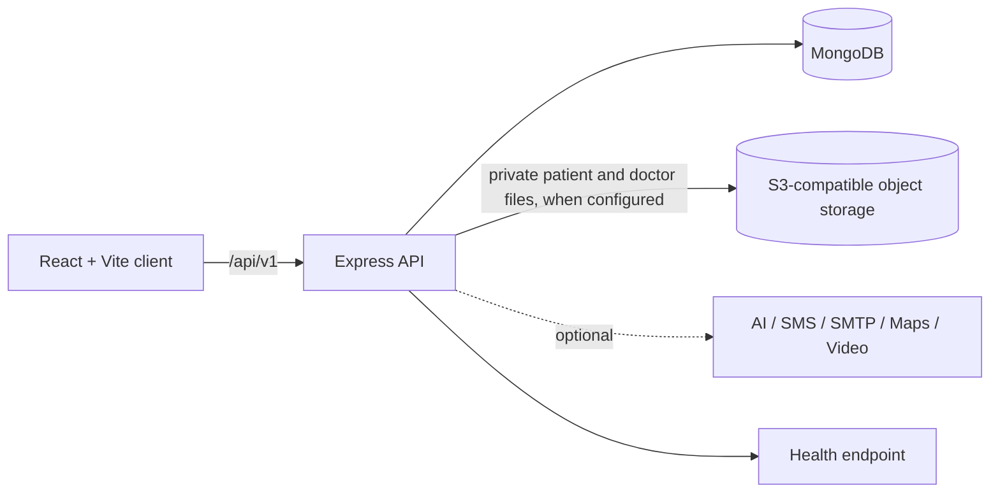
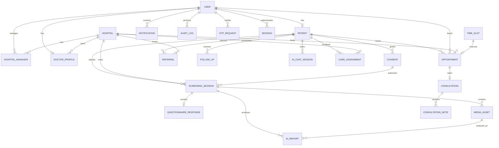

# Aarogya Drishti

Aarogya Drishti is a simulation-only AI-assisted oral health screening and care-access platform. This repository contains one Express/Mongoose API and one React/Vite web application. Authentication, administration, and a patient-to-doctor workflow are implemented for demonstration; no clinical services are available.

All current UI content is synthetic. Future AI output must remain advisory, separate from signed clinician notes, and must not diagnose, stage, prescribe, or claim that someone is cancer-free.

## Architecture



The patient workflow supports separate consent, a configurable screening questionnaire, optional photo checks and advisory AI, screening history, and appointment requests. The doctor workspace supports appointment review, assigned-patient history, signed note versions, referrals, follow-ups, and a consent-scoped screening review queue. These functions remain a simulation, not clinical services. Patient photographs require available private object storage; image-based screening analysis additionally requires a versioned PyTorch model bundle and explicit AI-processing consent. No validated model weights are included, so image-based disease screening is unavailable. The separate AI Health Assistant can provide general, non-diagnostic information when its server-side Gemini key is configured and the patient has given AI-processing consent. API middleware and hospital-scoped database filters enforce access; a visible simulation banner remains on every page.

## Requirements

- Node.js 22 or newer and npm
- MongoDB 7 or newer (local development), or Docker Desktop for Compose

## Local development

From this directory, install the npm workspaces:

```powershell
npm install
Copy-Item server\.env.example server\.env
```

Before starting the API, replace both example JWT values with separate, random values of at least 32 characters. Keep `server\.env` private; integration credentials belong only in the server environment. Start MongoDB separately, then run:

```powershell
docker compose --env-file server/.env up -d minio minio-init
npm run dev
```

For patient photo uploads, set `STORAGE_ACCESS_KEY` and `STORAGE_SECRET_KEY` in `server\.env` before starting MinIO. Use a unique local-development credential pair; MinIO uses these as its local administrator credentials. The Compose initialization service creates a private `aarogya-private-photos` bucket. MinIO's API and console are bound to `127.0.0.1` on ports 9000 and 9001. The API health check probes the configured bucket and reports `storage: available`, `unavailable`, or `not_configured`; it no longer reports storage as ready just because credentials exist.

The client is served at `http://localhost:5173`. It uses `https://aarogya-drishti-1-pgdm.onrender.com/api/v1` by default. Set `VITE_API_BASE_URL` in the client environment to override the backend URL.

For an existing database, back it up and run the additive, idempotent care-journey migration once before using the admin stage counts:

```powershell
npm run migrate:care-journey --workspace @aarogya/server
```

It adds a stage only to patient records that do not already have one. Existing relationships and clinical records are not rewritten; the initial stage is inferred from completed screening, clinician review, and follow-up records where available. The admin summary also infers stages for unmigrated legacy records.

## Docker Compose

Create `server\.env` as described above and set the MinIO credentials, then run:

```powershell
docker compose --env-file server/.env up --build
```

The client is available at `http://localhost:8080`. Compose starts MongoDB and MinIO, creates the private photo bucket, then starts the API and client. MongoDB and MinIO data persist in the `mongo_data` and `minio_data` volumes. These MinIO administrator credentials are for local development only and must never be reused in production.

## Scripts

| Command                                     | Purpose                                              |
| ------------------------------------------- | ---------------------------------------------------- |
| `npm run dev`                               | Run API and client in watch/development mode         |
| `npm run start --workspace @aarogya/server` | Start the API                                        |
| `npm run build --workspace @aarogya/client` | Build the client                                     |
| `npm test`                                  | Run API and client tests                             |
| `npm run lint`                              | Lint API and client source                           |
| `npm run format:check`                      | Check Prettier formatting                            |
| `npm run seed --workspace @aarogya/server`  | Create synthetic demo records in a non-production DB |
| `npm run reset --workspace @aarogya/server` | Replace only records marked `isSynthetic: true`      |

The API health endpoint is `GET /api/v1/health`. It reports API, database, and storage readiness and returns a degraded status when the private bucket cannot be reached.

Patient screening photos require the private S3-compatible storage settings in `server\.env` (`STORAGE_BUCKET`, `STORAGE_ACCESS_KEY`, and `STORAGE_SECRET_KEY`; also set `STORAGE_ENDPOINT` and `STORAGE_REGION` for local MinIO). Check the health endpoint before testing uploads: if `details.storage` is not `available`, uploads return `PRIVATE_STORAGE_UNAVAILABLE` and are not reported as saved. The patient photo is stored in the private bucket and its storage key, owner, session, and quality metadata are recorded in MongoDB. Retrieval uses authenticated patient/clinician routes. Do not put these credentials in the client or commit them.

The patient AI Health Assistant uses the server-side `GEMINI_API_KEY` and `GEMINI_MODEL` (defaults to `gemini-flash-lite-latest`) for general health information only. Provider outages are returned as errors rather than successful placeholder replies. The protected assistant API requires active AI-processing consent. Neither the assistant nor the image workflow diagnoses disease or prescribes treatment; the image-screening model remains disabled until clinically approved artifacts are configured.

## Synthetic seed data

The seed command creates one synthetic administrator, two hospital managers, two hospitals, six verified doctors, 20 patients, and six sample screenings with synthetic consent, questionnaire, private storage keys, and advisory AI reports. Before seeding, set a strong `SEED_STAFF_PASSWORD` in `server\.env`; it is used only as a temporary password for synthetic staff accounts, all of which require a password change at first sign-in. Never use a real or production password for this value. The seed does not create clinical documents.

The reset command deletes and recreates records marked `isSynthetic: true`. It refuses production environments and does not delete or alter append-only audit logs. Neither command can target a URI containing `production` or `prod-clinical`.

For the hackathon audit, current readiness scorecard, route inventory, demo walkthrough, and remaining gaps, see [Aarohan hackathon audit](docs/HACKATHON-AUDIT.md).

## Phase 3 authentication

- Patient self-registration at `/patient-password-setup` collects a name, mobile number, optional email, and password. A one-time SMS code must be verified before an account and patient profile are created. Patients can sign in with their email or mobile number and password; email is not verified by registration and must not be treated as proof of email ownership. OTP is used only for registration verification, not patient sign-in. Alternatively, a health worker can verify a patient in person and issue a single-use setup code from their own registration; the code expires after 30 minutes. Passwords are bcrypt-hashed at cost 12.
- Staff sign-in uses `POST /api/v1/auth/login`; staff identify by `staffId`, email, phone, or Mongo user ID. Passwords are bcrypt-hashed at cost 12. First sign-in can require password replacement; afterwards, a valid password creates a normal JWT-backed session without an authenticator or MFA step.
- When deploying this change to a database that has already stored authenticator data, run `npm run migrate:remove-mfa --workspace @aarogya/server` once. It removes only legacy TOTP secrets, backup-code hashes, and replay fields; it does not change passwords, user accounts, or sessions.
- For a local-only walkthrough, `SEED_DEMO=true npm run seed:demo-doctor-access --workspace @aarogya/server` enables doctor workspace access for five synthetic accounts and prints one-time temporary credentials. Their profiles remain pending professional verification; access is restricted to local development with `SEED_DEMO=true` and must not be used for real care.
- For password-based patient demos, set a strong local-only `SEED_STAFF_PASSWORD`, then run `SEED_DEMO=true npm run seed:demo-patient-logins --workspace @aarogya/server`. The command creates or resets five synthetic patient accounts to that configured password, clears their demo-account lockouts, and prints account identifiers only. It is restricted to local development; never use these accounts or this password for real patient data.
- Access JWTs expire in 15 minutes. A rotating opaque refresh token is stored hashed in `Session`, set only in an `httpOnly`, `SameSite=Strict` cookie, and revoked on logout/password reset/change. Recovery links are one-time and expire after 15 minutes.
- Protected routes verify the token and active session against MongoDB on each request. Hospital and care-assignment checks are enforced server-side. Patient profile reads are audited; login successes/failures, logout, password changes, and role changes are append-only audit records.
- `PATCH /api/v1/users/:userId/role` is admin-only and revokes existing sessions. `GET/PATCH /api/v1/users/me` and `GET/DELETE /api/v1/users/me/sessions` are session-scoped.

The client uses one responsive sign-in screen with a choice for each application role. Patient password setup is separate from sign-in; staff first-password-change and password recovery remain separate secure steps. English, Telugu, and Hindi are selectable on the sign-in screen. Access tokens and temporary flow tokens remain in memory; refresh is silent through the secure cookie. Role dashboards require both an authenticated session and the matching role.

## Phase 4 administration and hospital management

- Admin endpoints under `/api/v1/admin` create/edit/activate/deactivate hospitals, create initial manager accounts, manage user roles/status, view platform totals, filter audit events, and export a bounded CSV. Generated staff IDs and initial passwords are returned only in the creation response; initial passwords are bcrypt-hashed and require change at first sign-in.
- Manager endpoints under `/api/v1/hospital-manager` derive the assigned hospital from the authenticated account. Hospital profile/working hours, doctor listing/editing, appointment summary counts, and document review use server-side hospital filters. Managers cannot create hospitals. The appointment overview exposes counts only, not patient or clinical details.
- Doctor accounts remain pending until the manager reviews at least one qualification and one registration document and verifies the doctor. Changing qualification or registration details or uploading a new credential document returns the account to pending verification.
- Configure `STORAGE_BUCKET`, `STORAGE_REGION`, `STORAGE_ACCESS_KEY`, and `STORAGE_SECRET_KEY` for a private S3-compatible bucket. For AWS S3, leave `STORAGE_ENDPOINT` empty; for other S3-compatible services, set the provider endpoint. Uploads are limited to PDF/JPEG/PNG files up to 10 MB, stored without a public URL, and served only through authenticated routes. The storage credentials must never be exposed to the client.
- Management reads, edits, uploads, private-file reads, and exports generate append-only audit events. The manager overview includes operational appointment counts, including emergency requests, but never clinical details.

## Security and scope notes

- API startup validates configuration with Zod and loads server environment values with dotenv.
- Clinical screening, AI integrations, and provider-backed SMS/email/video/maps services are not clinical-ready. Storage must be configured before doctor file upload can be used.
- The simulation banner is persistent across all client routes. Online state is shown in the shared header, and English/Telugu language selection persists in local storage.

header, and English/Telugu language selection persists in local storage.

- Health status checks MongoDB connection state. A database outage prevents API startup or marks the health endpoint degraded.

## Phase 2 data model

All collections use timestamps, strict schemas, and an `isSynthetic` marker. Reference IDs are MongoDB ObjectIds.



| Model                   | Purpose / key constraints                                                                                             |
| ----------------------- | --------------------------------------------------------------------------------------------------------------------- |
| `User`                  | Identity, role, status, and optional hidden password hash; unique email/phone when present.                           |
| `Hospital`              | Hospital identity and contact/location metadata; unique code.                                                         |
| `HospitalManager`       | User-to-hospital assignment; unique hospital/manager pair.                                                            |
| `DoctorProfile`         | Doctor registration, verification, document storage keys, and owning hospital; unique user and hospital/registration. |
| `Patient`               | Patient profile and language preference; unique user.                                                                 |
| `Consent`               | Consent grant/withdrawal events by type and patient.                                                                  |
| `ScreeningSession`      | Patient screening session scoped to a hospital and consent.                                                           |
| `QuestionnaireResponse` | Versioned questionnaire answers; one response per screening session.                                                  |
| `MediaAsset`            | Private media metadata; stores `storageKey` only, never a public URL.                                                 |
| `AiReport`              | Advisory model output with required `notForClinicalUse: true`; immutable after creation.                              |
| `Appointment`           | Patient/doctor/hospital booking; unique doctor and slot start prevents double booking.                                |
| `TimeSlot`              | Doctor availability and interval; unique doctor and start time.                                                       |
| `Consultation`          | Hospital-scoped encounter linked to an appointment.                                                                   |
| `ConsultationNote`      | Immutable note versions linked by previous-version ID; edits create a new version.                                    |
| `Referral`              | Patient referral with originating/destination hospital and urgency.                                                   |
| `FollowUp`              | Patient follow-up task with due date and status.                                                                      |
| `AiChatSession`         | Patient conversation history and advisory disclaimer timestamp.                                                       |
| `Notification`          | User notification references and delivery/read status; displayed text uses i18n keys.                                 |
| `CareAssignment`        | Patient assignment to a care worker within a hospital.                                                                |
| `AuditLog`              | Append-only actor/action/resource access record; update and delete operations are blocked.                            |
| `OtpRequest`            | OTP verification state; stores hashes, never raw codes; expires automatically.                                        |
| `Session`               | User refresh-session metadata; stores a token hash and expires automatically.                                         |

Hospital-owned queries must use the authenticated hospital scope. The server helper `hospitalScopedFilter(hospitalId, filters)` forces the authorized `hospitalId` into the filter; use it for all hospital-scoped reads and writes.

## Product workflows and engineering documentation

- Patient: sign in, open `/patient`, record screening consent, complete the questionnaire, optionally grant photo and AI consents, submit a photo, then review the advisory summary and request an appointment.
- Clinician: sign in as a doctor, open `/doctor`, confirm an appointment, review the patient record when assigned and data-sharing consent is active, then create signed notes, referrals, and follow-ups. Provider-backed video calling is not yet connected.
- Secure image storage and model credentials are operator-configured server integrations; without them, photo analysis cannot complete.
- [Architecture and data model](docs/ARCHITECTURE.md)
- [OpenAPI snapshot](docs/openapi.yaml) (documented route coverage is not yet exhaustive)
- [Install and configuration guide](docs/INSTALL.md)
- [Gemini integration plan and limitations](docs/GEMINI-INTEGRATION.md)
- [Oral photo screening architecture, model-service API, validation plan, and regulatory gates](docs/oral-ai-screening.md)
- [Security design and role access matrix](docs/SECURITY-ACCESS-MATRIX.md)
- [Synthetic data and demo guide](docs/SYNTHETIC-DEMO.md)
- [Third-party and licence disclosure](docs/THIRD-PARTY-LICENSES.md)
- [Clinical pilot roadmap](docs/CLINICAL-PILOT-ROADMAP.md)
- [Phase 15 delivery checklist](docs/PHASE-15-CHECKLIST.md)
- [Privacy and governance](docs/PRIVACY-AND-GOVERNANCE.md) and [recovery runbook](docs/RECOVERY-RUNBOOK.md)

CI runs the repository lint and test commands, audits npm dependencies for high-or-higher advisories, builds the client, and builds both container images. Successful pushes to `main` publish versioned images to GHCR; deployment to a hosting environment remains an operator-controlled step.
