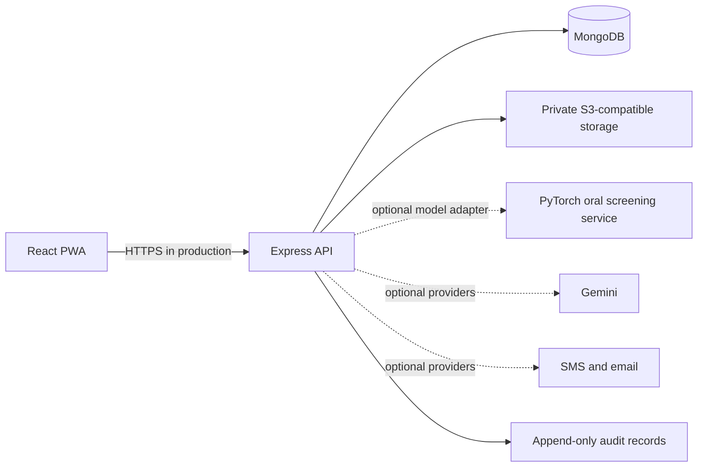

# Architecture and data model

## System boundary

The project is a simulation-oriented web application, not a clinical service. The browser runs React/Vite and calls the Express API under `/api/v1`. The API uses MongoDB through Mongoose. S3-compatible private storage, Gemini, SMTP/SMS, and video integrations are optional adapters; credentials belong only in the server environment. See the [README](../README.md) for local and Compose commands.



`server/src/app.js` mounts API routers and shared security middleware. Authentication uses short-lived access JWTs and rotating refresh sessions. Mongoose models enforce field shapes and indexes; route/service layers own validation, authorization, scope, and auditing. Sensitive patient data and field-registration data are encrypted by application services. The client stores access tokens in memory and uses IndexedDB for the explicitly supported offline flows.

The oral-photo screening flow, private model-service contract, patient report, clinician review queue, training/evaluation plan, dataset caveats, and CDSCO deployment gate are documented in [oral-ai-screening.md](./oral-ai-screening.md). No model weights or clinical validation evidence are included.

## Principal records

| Domain                    | Models                                                                                                                                   | Purpose                                                                                                        |
| ------------------------- | ---------------------------------------------------------------------------------------------------------------------------------------- | -------------------------------------------------------------------------------------------------------------- |
| Identity and directory    | `User`, `Patient`, `Hospital`, `HospitalManager`, `DoctorProfile`                                                                        | Account roles, patient profile, platform hospital directory, staff and verification metadata.                  |
| Screening                 | `Consent`, `Questionnaire`, `QuestionnaireResponse`, `ScreeningSession`, `MediaAsset`, `AiReport`, `OutsideReport`                       | Versioned consent, configurable questions, screening records, image metadata and immutable advisory reports.   |
| Care                      | `Appointment`, `TimeSlot`, `Consultation`, `ConsultationNote`, `VideoSession`, `Referral`, `FollowUp`, `UrgentRequest`, `CareAssignment` | Scheduling, relationship-scoped care, referrals, follow-up, and appointment-linked video metadata.             |
| Operations and governance | `Notification`, `AuditLog`, `OtpRequest`, `Session`, `PasswordResetToken`, `BreakGlassAccess`, `GovernanceRequest`, `SecurityAlert`      | Messaging status, append-only audit, authentication lifecycle and governance requests.                         |
| QR access               | `QrAccessGrant`, `QrScanAudit`                                                                                                          | Short-lived hashed patient QR grants and append-only scan outcomes.                                             |
| Optional field roles      | `FieldRegistration`, `Investigation`, `NavigatorActivity`, `SyncOperation`                                                               | Catchment-limited registration, investigation tracking, navigator activity, and idempotent offline operations. |
| AI assistant              | `AiChatSession`, `AiAssistantSession`, `AiAssistantSettings`                                                                             | Assistant conversation and settings records.                                                                   |

Model schemas and indexes are defined under `server/src/models`. The MongoDB `2dsphere` index exists for hospital points. This table is a guide, not a migration or exhaustive schema contract; consult model files for required fields and constraints.

## Appointment booking

Patients can browse active hospitals and appointable doctors, filter available time slots by date, submit an in-person appointment request with contact details, select pay-at-hospital, and download a PDF receipt containing a signed check-in QR. The QR encodes only an appointment identifier and HMAC; the check-in endpoint requires the assigned doctor, hospital, an accepted/confirmed booking, and a narrow check-in time window. Check-ins are audited and one-time. Patients can cancel or request a new slot; slot reservation/release and appointment updates run in MongoDB transactions. The doctor workspace provides the active daily queue, and admins can manage doctor specialty/fee and future availability in the admin console. A scheduled job sends one in-app reminder approximately 24 hours before accepted/confirmed appointments.

The API currently supports pay-at-hospital only. Razorpay/UPI checkout, SMS/email/WhatsApp appointment messages, and an actual browser video-call experience are not integrated; video requests are not offered until a media provider and participant UI are available. Do not treat in-app notifications as proof of external delivery. Existing doctor language and availability metadata are shown in the directory.

## Hospital directory and navigation

The patient Hospitals tab uses Leaflet with OpenStreetMap tiles and attribution. Location is only requested after a patient presses “Use my location”; city/district search remains available if permission is denied. Nearby search uses the hospital GeoJSON 2dsphere index. The directory supports center type, specialties/services, ownership, optional rating, verified coordinates, contact details, and weekly opening hours. Admin-entered coordinates are synchronized to GeoJSON for nearby queries.

Route previews use a server-side Google Maps Directions API proxy configured with `MAPS_KEY`; the key is never sent to the browser. The patient explicitly consents before the app sends their origin/destination to Google for route calculation. Google Maps opens separately for turn-by-turn navigation. Without a configured key, route previews fail with an actionable message, but direct Google Maps navigation remains available. Do not place `MAPS_KEY` in any `VITE_` variable. Restrict its Google Cloud API access to Directions API and server-side source IPs, enable quotas/billing alerts, rotate exposed keys, and use separate keys per environment.

The existing Alluri Sitarama Raju District seed is fictional. Its new coordinates are approximate demonstration points, facility names/contact details remain synthetic, ratings are intentionally absent, and the UI blocks navigation to these records. Replace them only with verified facilities, hours, phone numbers, coordinates, ownership, and ratings from an authorized data source before real-world use. OpenStreetMap tile requests disclose the browser's network IP and viewed map area to the tile provider.

When deploying the active-booking partial unique index, replace the earlier full unique appointment index once:

```javascript
db.appointments.dropIndex("doctorId_1_slotStart_1")
```

Then restart the API with Mongoose index creation enabled so it can create the partial unique index for `requested`, `accepted`, and `confirmed` appointments. Back up the database and verify the resulting indexes before applying this migration in production.

## Patient AI assistant

The floating voice/chat assistant is available throughout the app; the patient `/patient/assistant` link opens it. Its API is mounted at `/api/assistant` and the app's versioned alias `/api/v1/assistant`. It uses the server-only Anthropic Messages API and built-in tool schemas. Configure `ANTHROPIC_API_KEY` in `server/.env`; never put it in a `VITE_` variable. The default model is `claude-haiku-5-5`, configurable with `ANTHROPIC_MODEL`.

Patient session creation, reading, messaging, and confirmation require an authenticated patient and the latest active `ai_processing` consent. The server retains only the latest 12 chat turns and encrypts the transcript and pending action with the configured data-encryption key (or the access-secret-derived key for local development). A consent withdrawal blocks further assistant access. Claude receives the conversation only after these checks; no profile or screening records are included in its context.

Voice input and the optional “Hey Aarogya” wake phrase use browser Web Speech APIs when supported. Wake listening is off by default. Spoken replies use local browser speech synthesis and are off until enabled. Browser speech-recognition data may be handled by the browser's speech service; it is not sent to this app's server as an audio file. Unsupported browsers can use text chat. The assistant supports English, Hindi, Telugu, Tamil, Kannada, Malayalam, Bengali, and Marathi text; speech availability depends on the browser and installed voices.

Tool requests that can change records (appointment cancellation and reminder creation) require explicit confirmation. Booking confirmation opens `/patient/appointments` with the requested doctor/date/time for final slot selection and submission; rescheduling opens that workflow without changing the existing appointment. Camera, results, and report tools open the corresponding patient workflow sections. Patient cancellation is also available on the appointment page with a separate confirmation. A QR-code view and automatic external reminder delivery are not implemented. Hospital lookup uses the directory and opens a user-triggered map search; it does not access device location.

Emergency keyword checks run before model responses for heavy bleeding, breathing difficulty, swallowing difficulty, and supported English and Indian-language phrases. Matching messages receive 112 guidance; the UI provides a tap-to-call link and does not place calls automatically. Keyword matching is a safety aid, not a complete emergency detector. Assistant responses are informational only, never diagnoses, and the feature is not a clinical service.

## Trust and access boundaries

- Every protected API route must authenticate and authorize the role; patient-content routes must additionally enforce patient ownership or an active care relationship as appropriate.
- Hospital managers operate within assigned hospital scope. District dashboards aggregate only and suppress small groups; they are not patient-record views.
- Clients must not contain server secrets. Private object access must use authenticated server routes; public bucket access is not supported.
- Logs intentionally omit request bodies and redact credentials. Do not add names, phone numbers, images, questionnaire answers, AI prompts, or report text to operational logs.
- Production HTTPS must terminate at a trusted reverse proxy that sends the correct forwarded protocol. The API trusts one proxy hop in production; do not expose it directly to the internet.

## Known gaps

The repository does not include a complete clinical patient journey, a complete OpenAPI-generated contract, production key management, a verified Atlas/S3 deployment, or a clinical validation process. The configured Compose stack uses a local MongoDB volume and HTTP on the local host; it is not a production deployment recipe.

## Diet and Lifestyle

The patient `/patient/diet` page reads its stage, food, and regional meal ideas from `client/src/data/dietGuidance.json`; `dietPersonalization.js` filters those suggestions and builds a daily plan. English and Telugu copy lives in the corresponding locale catalogs. Meal selections, daily tracking, hydration counts, and preferences are stored in browser local storage scoped by patient account; meal reminders use browser notifications and require the page to remain open. No nutrition data is sent to the server.

The guidance JSON carries `clinicalReview.status`, `reviewer`, and `reviewedAt`. The included sample content is explicitly marked `pending` and the page warns that it has not received clinician review. A qualified clinician must review and approve the content before it is represented as reviewed or used in production. Post-treatment users are directed to follow their oncologist or dietitian; the page is general information, not a medical nutrition plan. The voice assistant's `get_diet_plan` action opens this page.

## Temporary patient QR

The patient dashboard creates a QR on explicit request. Its payload is only `AAROGYA1:` plus 256 bits of random entropy; it contains no name, patient ID, appointment details, or report. The API stores only a SHA-256 token hash and a five-minute expiry. A conditional atomic claim makes each grant single-use; creating a replacement revokes earlier grants, and the patient can revoke all active grants at any time. Expired grants are also removed asynchronously by MongoDB TTL, while every use checks `expiresAt`, `revokedAt`, and `consumedAt` directly.

Scanning is available in the authenticated doctor workspace. The API accepts QR payloads only for the `doctor` role and only when the patient has active `data_sharing` consent and an active care assignment to that doctor in their hospital. It returns a read-only summary (patient name, age when available, patient ID, screening results, appointment dates/statuses, and report metadata). It does not expose image storage keys or permit changes. Patient-facing scan details, blood group, and emergency contacts are not currently stored or included. Hospital-manager and other staff roles cannot scan or open these summaries.

`QrScanAudit` is append-only and stores scanner, patient/grant when resolvable, hospital, request ID, timestamp, and outcome; QR secrets are never logged. Token issuance and revocation also create `AuditLog` events. Camera permission is requested only after the doctor starts the scanner; scanned data is sent to the protected API over the configured API origin.

## Experimental oral-image model adapter

`model-service/app.py` defines a private FastAPI adapter: image bytes are quality-checked by the existing API, normalized and segmented by a supplied TorchScript foreground-mask model, classified by a five-class ResNet18 checkpoint, and accompanied by Grad-CAM. The Express service authenticates to it with a server-only bearer token, validates all returned classes/probabilities/heatmap bytes, stores heatmaps in private encrypted object storage, and saves immutable report metadata. The questionnaire scoring rules are versioned separately and surfaced with their factors.

This repository includes no trained segmentation or oral-photo classification checkpoints and no clinical validation. The adapter reports `not_ready` without configured artifacts; the user journey must continue storing a photo without showing a fabricated classifier result. The current score thresholds, examples, confidence values, segmentation, and attention overlay are engineering scaffolding only and must not be used for diagnosis, triage, or care decisions. Confidence is not calibrated. Low risk does not rule out a concern. Moderate/high results advise clinician review independently of the numerical score. The clinician feedback endpoint appends corrections; it does not automatically alter model weights or reports.

Potential research inputs include licensable, consented clinical visible-light image cohorts used by peer-reviewed oral-lesion image studies, after obtaining the data and label rights from the investigators. Public oral cancer cytology datasets such as those studied in [Koriakina et al. (2024)](https://pmc.ncbi.nlm.nih.gov/articles/PMC11060593/) contain microscope/brush-sample imagery and are not interchangeable with phone photographs of a patient's mouth. [Song et al. (2021)](https://pubmed.ncbi.nlm.nih.gov/34745746/) is a relevant reliability-method reference; access, image modality, labels, and reuse permission must be confirmed before treating its data as a trainable public dataset. For actual screening photos, establish an independently consented Indian clinical cohort with clinician-confirmed labels and lesion masks; public availability and license must be verified before use.

Before any clinical research use, split by patient and preferably by site/device, lock a held-out prospective cohort, preregister thresholds, report sensitivity/specificity with confidence intervals and calibration, and measure abstention/quality rejection. Report performance by Fitzpatrick skin-tone group or a locally validated pigmentation measure, site, camera/device, oral region, sex, and age; include subgroup counts and uncertainty, not only pooled accuracy. Assess segmentation with Dice/IoU and Grad-CAM localization with clinician-annotated regions. Conduct external and prospective validation and clinician-led safety review before considering deployment.
