# Oral photo screening agent

## Status and safety boundary

This repository contains an integration and serving scaffold, **not a validated medical model**. No oral-cavity detector, lesion-segmentation weights, classifier weights, calibration set, or clinical validation report is supplied. The model service remains `not_ready` until a complete versioned artifact bundle is installed. Do not enable it for real patients or present its output as clinically accurate.

The patient-facing text is advisory only. Every result says “Screening result — not a diagnosis.” An unclear result does not show a finding, and a low-risk result includes: “This does not rule out cancer. See a doctor if the symptom lasts more than 2 weeks.” Severe symptoms continue to trigger the separate emergency guidance; emergency care never depends on model output.

## Architecture

```mermaid
flowchart LR
  Patient[Patient React capture/upload] --> Consent[Explicit screening, imaging, and AI consent]
  Consent --> API[Express API: auth, MIME/size/resolution/blur/brightness checks]
  API --> Validate[Private FastAPI validation: oral-cavity detector]
  Validate -->|Retake reasons| Patient
  Validate -->|Accepted image| Store[(Encrypted private image storage)]
  Store --> Segmentation[Segmentation module]
  Segmentation --> Classification[Temperature-calibrated classifier]
  Classification --> Gate[Uncertainty gate]
  Segmentation --> GradCAM[Grad-CAM overlay]
  Gate --> Fusion[Questionnaire fusion and conservative risk category]
  GradCAM --> Report[(Immutable versioned AI report)]
  Fusion --> Report
  Report --> Audit[Append-only prediction audit]
  Report -->|High or unclear| Review[(Clinician review task)]
  Report --> PatientUI[Patient result, image/heatmap, and PDF]
  Review --> Doctor[Assignment- and consent-scoped clinician queue]
  Doctor --> Feedback[(Immutable clinician correction for evaluation)]
```



The modules in `model-service/` separate image quality/oral-cavity validation, segmentation, classification, uncertainty gating, and explainability. Questionnaire fusion runs in the API so the image service receives no patient identity or questionnaire answers. Photos are sent only to this configured internal model service after AI-processing consent; the oral-image route no longer falls back to Gemini or another third-party model.

The patient app already has English/Telugu consent, camera/upload, preview, image deletion, result/history, report image/heatmap, appointment/call links, and diet guidance. The server stores private images and serves authenticated, no-store responses. A server-generated PDF includes the original photo and heatmap when the photo remains available. The patient result page is localized; the current PDF generator uses English text.

If automated analysis is unavailable, the patient can download an authenticated photo-record PDF containing saved images and capture metadata. It explicitly states that no AI finding was generated and is not a diagnosis or negative screening result; it does not substitute for an AI report or clinician assessment.

## Serving API

The internal FastAPI service requires a bearer token and a model manifest whose hashes match the deployed artifact files.

### `GET /health`

Returns `ready` only when the oral detector, segmentation model, classifier, manifest, and calibration metadata load successfully. A missing model is not silently replaced by a demo prediction.

### `POST /v1/oral-screenings/validate`

Request:

```json
{
  "imageBase64": "<base64 JPEG or PNG, at most 1 MB>",
  "mimeType": "image/jpeg",
  "region": "tongue_top"
}
```

Returns an `accepted` flag, dimensions, non-identifying quality metrics, and retake reason codes (`resolution`, `blur`, `too_dark`, `glare`, `not_oral`). Rejected images are not stored or sent for lesion prediction. The detector necessarily evaluates the image to decide whether it shows an oral cavity. The patient UI maps each reason to English/Telugu retake guidance.

### `POST /v1/oral-screenings/predict`

Accepted photos proceed through segmentation, classification, calibrated probability generation, and Grad-CAM. The response is either:

```json
{
  "modelVersion": "immutable-version",
  "status": "classified",
  "finding": "white_patch",
  "confidence": 0.0,
  "probabilities": {
    "white_patch": 0.0,
    "red_patch": 0.0,
    "ulcer_like_area": 0.0,
    "raised_area": 0.0,
    "no_visible_finding": 0.0
  },
  "heatmapBase64": "<PNG>",
  "imageQuality": "adequate",
  "uncertaintyReason": null
}
```

or a result with `status: "unclear"`, `finding: null`, and no heatmap. The API rejects malformed output, invalid probabilities, mismatched confidence, and invalid heatmap data. The Express layer records the immutable report, model version, questionnaire-fusion version, audit event, and—when risk is high or unclear—a clinician-review task. Service failures become an unclear clinician-review report, not a guessed class.

## Model artifact and deployment contract

There are deliberately no model weights in this repository. A deployment needs:

- A separately evaluated oral-cavity detector with output class order `[oral_cavity, not_oral_cavity]`.
- A segmentation model producing a one-channel lesion-region mask.
- The classifier state dict for the five documented finding classes.
- A manifest based on `model-service/model-manifest.example.json`, with immutable version, SHA-256 for each artifact, separate validation/calibration dataset IDs, temperature-scaling temperature, and thresholds chosen before evaluation.
- Internal-only `MODEL_API_TOKEN`, `ORAL_MODEL_VERSION`, artifact paths, and matching `ORAL_MODEL_API_URL` / `ORAL_MODEL_API_TOKEN` on the API. Never use a `VITE_` variable for model credentials.

The optional Compose service is under the `oral-model` profile. Configure real secrets and artifacts through the deployment secret manager and a read-only model-volume mount; do not commit them. A manifest is a provenance mechanism, not proof of clinical validity. The API is intentionally unavailable until the manifest and all artifact hashes pass checks.

`model-service/research_training.py` is an isolated, research-only EfficientNetB0 trainer for the four documented clinical-photo categories. It rejects histopathology datasets and writes a research checkpoint that is **not compatible with or deployable to** the live service, which expects separate oral-cavity detector, segmentation, and classifier artifacts. No dataset or weights are currently available to train or validate either pipeline.

## Training and evaluation notebook outline

Create a version-controlled notebook only after data rights and clinical labels are approved. Keep personally identifying data out of notebooks and experiment logs.

1. **Dataset inventory:** record source, version, license, collection device, clinical site, label definition, diagnosis reference standard, image modality, patient IDs, skin-tone representation, lighting, and missing metadata. Exclude data with unclear consent or derivative/training restrictions.
2. **Patient-level split:** split by patient before augmentation; reserve a locked test set and a site/time-held-out external test set. Do not leak near-duplicate frames across splits.
3. **Image QC:** report the exclusion rate by class, skin-tone group, lighting, camera, and site. Train/test the oral-cavity detector and lesion-segmentation masks separately from the finding classifier.
4. **Fine-tuning:** start from a documented ImageNet-pretrained encoder; fine-tune only on the correct clinical-photo modality. Use clinician-reviewed lesion boxes/masks for segmentation. Keep a distinct “unclear/ungradable” path rather than forcing every photo into a lesion class.
5. **Class imbalance:** use patient-balanced sampling, class-weighted loss or focal loss, and training-only augmentation. Do not duplicate patients across splits or use synthetic minority images in validation/test. Report per-class support and confidence intervals.
6. **Lighting and skin-tone robustness:** use realistic, label-preserving exposure/white-balance augmentation; do not use skin-tone labels as diagnosis shortcuts. Collect a sufficiently powered, consented, clinician-labelled cohort across skin tones, sites, ages, cameras, and lighting. Measure image-quality rejection and false-negative rates for each subgroup.
7. **Calibration and threshold selection:** fit temperature scaling on a separate calibration set. Select the operating threshold on development data to meet a prespecified high-sensitivity target; freeze it before the locked test. If the threshold is not met, mark the model not deployable. Do not call raw softmax scores confidence probabilities.
8. **Locked evaluation:** report sensitivity, specificity, ROC-AUC, PR-AUC, calibration (Brier score/ECE), per-class counts, and a confusion matrix with confidence intervals. Break out per-skin-tone, sex, age, site, camera, and lighting subgroup results; mark small or missing groups as not estimable. Include external validation and abstention/unclear coverage.
9. **Clinician feedback:** treat corrections as adjudication data, not immediate training labels. Preserve original prediction, reviewer, timestamp, corrected class, and model version. Resolve disagreements and relabel under a clinical protocol before a new training run.
10. **Drift and release review:** monitor input-quality rejection, class/score/unclear distributions, subgroup mix, model-version counts, clinician disagreement, and outcome-based performance when labels become available. Set alert thresholds and rollback owners; do not infer clinical drift from a changed score distribution alone.

### Dataset candidates and limits

- **PhotoMOCI (Photographic Multi-purpose Oral Cancer Imaging Dataset)** is a potentially relevant photographic dataset candidate listed on Kaggle: [dataset page](https://www.kaggle.com/datasets/marcoparola7/poci-photographic-oral-cancer-imaging-dataset). The listing identifies a **CC BY-ND 4.0** license. That restriction may not permit fine-tuning or creating derivatives; obtain rights-holder/legal approval before downloading for model training. Independently inspect its image types, patient-level labels, reference standard, duplicates, consent, and demographic/lighting coverage. Do not assume its title or Kaggle availability makes it a clinically validated benchmark.
- Public OSCC histopathology/microscopy collections are not interchangeable with smartphone photographs of oral mucosa. They may be considered only for carefully justified representation-learning experiments, and must not be used as the locked test set or cited as validation of the photo workflow.
- Do not use any dataset as a substitute for a representative, consented external clinical-photo test set. If license, image provenance, patient-level splits, reference labels, or subgroup metadata cannot be verified, exclude it.

## Clinician review, privacy, and regulation

High and unclear reports create a review task. The doctor queue is limited to the clinician’s active care assignments and the patient’s latest active data-sharing consent. Corrections are append-only feedback records and complete the associated task. No clinician review is created from a low-only score; patients still receive the low-risk warning and care links.

Images are retained only with explicit imaging consent, and model processing additionally requires AI-processing consent. Image deletion removes the stored original and associated heatmap; the immutable report text remains. No third-party image API is used by this pipeline. Review every storage provider’s encryption, retention, access logging, deletion, backup, and key-rotation behavior before a real deployment.

Before any real clinical use in India, obtain regulatory and legal advice on whether the intended function is Software as a Medical Device under the Medical Devices Rules, 2017 and applicable CDSCO software guidance; determine classification, licensing/registration, quality-management, clinical-investigation, labeling, and post-market obligations. Also obtain ethics approval, clinical ownership, data-protection review, and independent safety/security review. This repository does not establish regulatory compliance or clinical performance.
